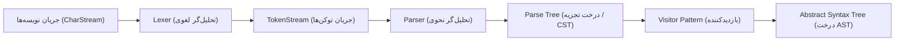

# ۱. مبانی Syntax Analysis و جایگاه Parser {#sec-intro}

در معماری کامپایلر، مرحلهٔ syntax analysis (تحلیل نحوی) وظیفه دارد جریان خطی و بدون ساختار توکن‌های ورودی را که توسط lexer تولید شده‌اند، اعتبارسنجی کرده و ساختار سلسله‌مراتبی و درختی آن را بر اساس قواعد یک دستور زبان معین کشف نماید.

<definition title="گرامر مستقل از متن (Context-Free Grammar)" id="def-cfg">

دستور زبان یا context-free grammar (دستور زبان مستقل از متن) که به اختصار CFG نامیده می‌شود، با یک چهارتایی ریاضی تعریف می‌گردد:

$$G = (V, \Sigma, R, S)$$

* $V$: مجموعه‌ای متناهی از نمادهای ناپایانه یا non-terminal (متغیرهای نحوی نظیر `expr` یا `stmt`).
* $\Sigma$: مجموعه‌ای متناهی از نمادهای پایانه یا terminal که همان نوع توکن‌های تولیدشده توسط lexer هستند (نظیر `ID` یا `PLUS`).
* $R$: مجموعه‌ای از قواعد تولید یا production rules به فرم $A \to \alpha$ که در آن $A \in V$ و $\alpha \in (V \cup \Sigma)^*$.
* $S$: نماد آغازین گرامر یا start symbol ($S \in V$).

</definition>

تحلیل‌گر نحوی خروجی خود را در قالب یک ساختار درختی سازمان‌دهی می‌کند. در مهندسی کامپایلر، تمایز میان دو نوع درخت از اهمیت بنیادی برخوردار است:

1. **درخت تجزیه یا parse tree (که به concrete syntax tree یا CST نیز معروف است):** این درخت نشان‌دهندهٔ تطابق گام‌به‌گام و جزء‌به‌جزء متن با تمام قواعد گرامر است و شامل تمامی علائم نگارشی، پرانتزها، سمی‌کالن‌ها و نمادهای واسطه‌ای می‌باشد.
2. **درخت نحو انتزاعی یا abstract syntax tree (به اختصار AST):** درختی پیراسته و بهینه‌سازی‌شده است که نویزهای گرامری (مانند پرانتزهای گروه‌بندی یا کلمات کلیدی دستوری) را حذف کرده و فقط اپراتورها و عملوندهای معنادار را جهت فازهای ارزیابی معنایی و تولید کد نگهداری می‌کند.



<mybox type="info">

ابزار <en>ANTLR4</en> پس از خواندن توکن‌ها، ابتدا به صورت خودکار یک parse tree در حافظه ایجاد می‌کند. سپس با بهره‌گیری از الگوهای پیمایش (Visitor یا Listener)، برنامه‌نویس این درخت را پردازش کرده و آن را به یک AST تبدیل می‌نماید.

</mybox>

---

# ۲. ساختار فایل Parser Grammar در <en>ANTLR4</en> {#sec-parser-grammar}

در پروژه‌های صنعتی و مقیاس‌پذیر، همواره توصیه می‌شود که قوانین لغوی و نحوی در دو فایل کاملاً مجزا تفکیک شوند. فایل تحلیل نحوی با پسوند `.g4` ذخیره شده و با عنوان `parser grammar` معرفی می‌گردد.

## ۲–۱ تعریف هدر و دایره لغات (Token Vocabulary)

برای اینکه parser بداند چه توکن‌هایی در سیستم معتبر هستند، باید به دایره لغات فایل لکسر متصل شود. این ارتباط از طریق بخش `options` برقرار می‌گردد:

```antlr
parser grammar TemplateParser;

options {
    tokenVocab = TemplateLexer;
}
```

با این کار، تمامی توکن‌های تعریف‌شده در `TemplateLexer.g4` (مانند `ID`، `INT_VAL`، `IF`، `SEMI`) مستقیماً و بدون نیاز به تعریف مجدد، به عنوان نمادهای پایانه (terminals) در قواعد پارسر قابل استفاده خواهند بود.

## ۲–۲ قرارداد نام‌گذاری و تمایز قواعد

در سینتکس <en>ANTLR4</en>، تمایز میان قواعد لغوی و نحوی صرفاً بر اساس بزرگی و کوچکی اولین حرف قاعده مشخص می‌شود:
* **قواعد لکسر (Terminals):** باید با **حرف بزرگ لاتین** شروع شوند (مانند `PLUS`، `IDENTIFIER`، `STRING_LITERAL`).
* **قواعد پارسر (Non-terminals):** باید با **حرف کوچک لاتین** شروع شوند (مانند `program`، `statement`، `expression`).

## ۲–۳ قاعدهٔ ریشه و ضرورت صریح نماد <en>EOF</en>

همواره اولین قاعده در فایل پارسر، به عنوان قاعدهٔ ریشه یا start rule در نظر گرفته می‌شود.

<remark title="چرا انتهای قاعدهٔ آغازین باید صراحتاً با EOF خاتمه یابد؟">

اگر نماد انتهای فایل (<en>EOF</en>) را در پایان قاعدهٔ ریشه قید نکنید:
```antlr
// شیوهٔ نادرست و پرخطر:
program : statement* ;
```
چنانچه ورودی دارای خطای نحوی باشد، پارسر ممکن است پس از خواندن چند سطر درست متوقف شده و بدون اعلام خطا، بقیهٔ فایل را کلاً نادیده بگیرد! اما اگر قاعده را به صورت زیر بنویسید:
```antlr
// شیوهٔ صحیح و استاندارد:
program : statement* EOF ;
```
پارسر ملزم می‌شود که کل جریان ورودی را تا آخرین بایت فایل بخواند و اعتبارسنجی نماید.

</remark>

## ۲–۴ ترتیب وابستگی در فرآیند Build و فایل‌های .tokens

هنگامی که گرامر لکسر و پارسر را در دو فایل مجزا (`TemplateLexer.g4` و `TemplateParser.g4`) تفکیک می‌کنید، یک رابطهٔ وابستگی صریح میان آن‌ها شکل می‌گیرد. پارسر برای کامپایل شدن، نیازمند فایل خروجی لکسر با پسوند `.tokens` است.

<mybox type="warning" title="خطای رایج: عدم رعایت ترتیب کامپایل گرامرها">

اگر فایل پارسر را پیش از ساخت لکسر کامپایل نمایید، با خطای زیر روبه‌رو خواهید شد:
```text
error(160): cannot find tokens file ./TemplateLexer.tokens
```
بنابراین، چرخهٔ بیلد همواره باید ابتدا فایل لکسر را پردازش کند تا نگاشت نام توکن‌ها به شناسه‌های عددی در `TemplateLexer.tokens` استخراج شود:

```bash
# ۱. تولید واژگان و فایل .tokens از روی لکسر
java -jar utils/antlr-4.13.1-complete.jar TemplateLexer.g4

# ۲. تولید کدهای پارسر با اتکا به واژگان آماده‌شده
java -jar utils/antlr-4.13.1-complete.jar -visitor TemplateParser.g4
```

</mybox>

## ۲–۵ اپراتورهای فرم تعمیم‌یافته (EBNF) و تولید متدهای لیستی

در گرامرهای سنتی به فرم <en>BNF</en>، ساختارهای تکراری (مانند لیست آرگومان‌ها یا مجموعه‌ای از عبارات) ناچاراً با قواعد بازگشتی تعریف می‌شدند:

```antlr
// شیوهٔ سنتی و بازگشتی در BNF
args : args COMMA expr | expr ;
```

ابزار <en>ANTLR4</en> به صورت بومی از عملگرهای extended Backus-Naur form (فرم تعمیم‌یافتهٔ باکوس-نائور یا <en>EBNF</en>) پشتیبانی می‌کند:
* `?`: انطباق اختیاری (صفر یا یک بار).
* `*`: تکرار بدون سقف (صفر یا چندین بار).
* `+`: تکرار مثبت (حداقل یک بار).
* `(...)`: گروه‌بندی زیرقواعد و الگوهای تکراری.

با بهره‌گیری از <en>EBNF</en>، می‌توان همان لیست آرگومان‌ها را بسیار خواناتر تعریف کرد:

```antlr
// شیوهٔ استاندارد و مدرن EBNF در ANTLR4
args : expr (COMMA expr)* ;
```

<mybox type="info" title="تولید خودکار متدهای لیستی در کدهای جاوا">

هر زمان در قاعده‌ای از عملگرهای `*` یا `+` روی یک نماد استفاده شود، <en>ANTLR4</en> در کلاس Context متناظر، یک متد بازگردانندهٔ لیست به صورت `java.util.List` تولید می‌کند:

```java
// دسترسی به تمامی عبارات موجود در لیست:
List<TemplateParser.ExprContext> allExprs = ctx.expr();

// دسترسی مستقیم به اولین عبارت با ایندکس:
TemplateParser.ExprContext firstExpr = ctx.expr(0);
```

</mybox>

---

# ۳. موتور تجزیهٔ <en>ALL(*)</en>: مبانی و مزایا {#sec-allstar}

پارسر سنتی بر پایهٔ الگوریتم‌های کلاسیک نظیر <en>LL(1)</en> یا <en>LL(k)</en> عمل می‌کرد که در آن‌ها تصمیم‌گیری برای انتخاب شاخهٔ گرامری، منحصراً بر اساس نگاه کردن به یک یا تعداد محدودی توکن بعدی (lookahead) انجام می‌شد. این محدودیت طراح زبان را مجبور می‌کرد که گرامر را به شکلی دست‌کاری کرده و فاکتورگیری چپ (left factoring) انجام دهد تا از تداخل شاخه‌ها جلوگیری شود.

در مقابل، ابزار <en>ANTLR4</en> از موتور نوآورانه و اختصاصی موسوم به <en>ALL(*)</en> یا Adaptive LL Star بهره می‌برد.

<definition title="مفهوم الگوریتم ALL(*)" id="def-allstar">

موتور <en>ALL(*)</en> در لحظهٔ اجرای برنامه (runtime) و با برخورد به هر چندراهی تصمیم‌گیری نحوی، به صورت پویا شبکه‌ای از حالت‌ها به نام Augmented Transition Network را شبیه‌سازی می‌کند. این الگوریتم می‌تواند بدون هیچ‌گونه سقف ثابت برای $k$، تا هر عمقی از توکن‌های بعدی پیشروی کند تا مسیر درست را تشخیص دهد.

</definition>

ویژگی‌های کلیدی موتور <en>ALL(*)</en>:
* **حذف نیاز به فاکتورگیری چپ دستی:** نیازی به بازنویسی گرامر به شیوه‌های ناخوانا برای تمایز پیشوندهای مشترک وجود ندارد.
* **سرعت خطی در عمل:** علیرغم قدرت تئوری بالا، با بهره‌گیری از تکنیک‌های caching و جدول‌های حافظه‌دار، زمان اجرای آن بر روی کدهای واقعی برنامه‌نویسی تقریباً خطی ($O(n)$) است.

---

# ۴. بازگشت به چپ (Left Recursion) و اولویت عملگرها {#sec-precedence}

یکی از بزرگ‌ترین چالش‌های طراحی گرامر در پارسرهای از بالا به پایین سنتی، مسئلهٔ left recursion (بازگشت به چپ) بوده است؛ یعنی حالتی که یک قاعده خودش را در اولین موقعیت سمت راست فراخوانی کند:

```antlr
expr : expr '+' expr ;
```

در پارسرهای نسل قدیم، این ساختار منجر به حلقهٔ بی‌نهایت (infinite recursion) و سرریز پشته (stack overflow) می‌شد. برنامه‌نویسان مجبور بودند برای تعریف چهار عمل اصلی، گرامر را به چندین سطح ساختگی (`expr`، `term`، `factor`) تقسیم کنند.

## ۴–۱ پشتیبانی بومی از بازگشت به چپ مستقیم در <en>ANTLR4</en>

ابزار <en>ANTLR4</en> قواعد حاوی direct left recursion (بازگشت به چپ مستقیم) را به صورت خودکار شناسایی کرده و آن‌ها را در زمان تولید کد به ساختارهای تکراری غیربازگشتی تبدیل می‌نماید. بنابراین نوشتن گرامر عبارات ریاضی به طبیعی‌ترین و خواناترین شکل ممکن امکان‌پذیر است:

```antlr
expr : expr MULT expr
     | expr PLUS expr
     | INT_VAL
     ;
```

## ۴–۲ قانون طلایی اولویت عملگرها (Operator Precedence)

در <en>ANTLR4</en> نیازی به شکستن قواعد برای تعیین اولویت نیست. قاعدهٔ تعیین اولویت فوق‌العاده شفاف و مستقیم است:

<mybox type="success" icon="zap">

**قانون اولویت بر اساس ترتیب:**
شاخه‌ای که در خط بالاتری از تعریف قاعده نوشته شود، اولویت بالاتری دارد. شاخه‌های پایین‌تر اولویت کمتری دارند.

</mybox>

به عنوان مثال، در گرامر زیر ضرب و تقسیم دارای اولویت بالاتری نسبت به جمع و تفریق هستند؛ زیرا بالاتر تعریف شده‌اند:

```antlr
expr : expr (MULT | DIV) expr    // اولویت بالا
     | expr (PLUS | MINUS) expr   // اولویت پایین‌تر
     | INT_VAL
     ;
```

## ۴–۳ تعیین جهت شرکت‌پذیری (Associativity)

به طور پیش‌فرض، تمام عملگرهای بازگشتی در <en>ANTLR4</en> به صورت شرکت‌پذیر از چپ یا left-associative پردازش می‌شوند؛ یعنی عبارت `1 - 2 - 3` به صورت `(1 - 2) - 3` در درخت تجزیه تفسیر می‌گردد.

اما برای برخی عملگرها (مانند عملگر توان `^` یا عملگر انتساب زنجیره‌ای `=`)، نیاز به شرکت‌پذیری از راست یا right-associative داریم تا عبارت `2 ^ 3 ^ 4` به عنوان `2 ^ (3 ^ 4)` شناخته شود. این کار با گزینهٔ `<assoc=right>` در ابتدای شاخه انجام می‌شود:

```antlr
expr : <assoc=right> expr POW expr    // شرکت‌پذیر از راست
     | expr (MULT | DIV) expr         // شرکت‌پذیر از چپ (پیش‌فرض)
     | expr (PLUS | MINUS) expr       // شرکت‌پذیر از چپ (پیش‌فرض)
     | INT_VAL
     ;
```

## ۴–۴ تمایز بازگشت به چپ مستقیم از غیرمستقیم (Direct vs. Indirect Left Recursion)

پشتیبانی خودکار <en>ANTLR4</en> منحصراً مربوط به direct left recursion (بازگشت به چپ مستقیم) است که در آن قاعده مستقیماً نام خودش را در اولین موقعیت سمت راست فراخوانی کند ($A \to A \alpha$).

اما اگر دو یا چند قاعده به صورت چرخه‌ای یکدیگر را در موقعیت چپ فراخوانی کنند، به آن indirect left recursion (بازگشت به چپ غیرمستقیم یا متقابل) گفته می‌شود:

```antlr
// خطای کامپایل در ANTLR4:
decl : varDecl | type ID SEMI ;
type : decl LBRACK RBRACK | INT ;
```

در این وضعیت، <en>ANTLR4</en> با خطای زیر متوقف می‌شود:
```text
error(119): The following sets of rules are mutually left-recursive [decl, type]
```

<mybox type="warning" title="حل بازگشت به چپ غیرمستقیم">

ابزار <en>ANTLR4</en> نمی‌تواند بازگشت‌های غیرمستقیم را به صورت خودکار بازنویسی کند. برای رفع این مشکل، باید زنجیرهٔ فراخوانی‌ها را به صورت دستی بازنویسی (inline یا فاکتورگیری) کرده و آن را به فرم تکراری <en>EBNF</en> تبدیل نمود:

```antlr
// فرم اصلاح‌شده و بدون چرخه:
decl : type ID SEMI ;
type : INT (LBRACK RBRACK)* ;
```

</mybox>

---

# ۵. برچسب‌گذاری قواعد و شاخه‌ها (Rule Labels: `# Label`) {#sec-labels}

هنگامی که یک قاعده شامل چندین شاخهٔ جایگزین (alternatives) است، شیوه‌ای که <en>ANTLR4</en> کلاس‌های کد جاوا را برای آن تولید می‌کند، تعیین‌کنندهٔ کیفیت کل معماری کامپایلر خواهد بود.

## ۵–۱ پیامد عدم برچسب‌گذاری

اگر قاعدهٔ `expr` را بدون برچسب رها کنید:

```antlr
expr : expr MULT expr
     | expr PLUS expr
     | ID
     | INT_VAL
     ;
```

در جاوا، کامپایلر فقط یک کلاس بزرگ به نام `ExprContext` تولید می‌کند. برای اینکه بفهمید این شیء کدام شاخه است، ناچارید کدهای آشفته با انواع `if-else` و بررسی `null` بودن اعضا بنویسید:

```java
// کدنویسی ضعیف و ناخوانا به دلیل نبود برچسب
if (ctx.MULT() != null) { ... }
else if (ctx.PLUS() != null) { ... }
```

## ۵–۲ مزیت معماری با برچسب‌گذاری شاخه‌ها

با افزودن پسوند `# LabelName` به انتهای هر شاخه، <en>ANTLR4</en> برای تک‌تک آن‌ها کلاس‌های Context اختصاصی و جداگانه در جاوا مشتق می‌کند:

```antlr
expr:
    LPAR expr RPAR                 # ParensExpr
    | <assoc=right> expr POW expr  # PowerExpr
    | expr (MULT | DIV) expr       # MulDivExpr
    | expr (PLUS | MINUS) expr     # AddSubExpr
    | ID                           # IdExpr
    | INT_VAL                      # IntLiteralExpr
    ;
```

با این نام‌گذاری، کلاس‌های زیر در جاوا ساخته می‌شوند:
* `TemplateParser.ParensExprContext`
* `TemplateParser.PowerExprContext`
* `TemplateParser.MulDivExprContext`
* `TemplateParser.AddSubExprContext`
* `TemplateParser.IdExprContext`
* `TemplateParser.IntLiteralExprContext`

این قابلیت، فونداسیون طراحی فاز بعدی کامپایلر (طراحی Visitor و ساخت درختی AST) را به صورت شی‌ءگرا و type-safe فراهم می‌سازد.

## ۵–۳ برچسب‌گذاری عناصر درون قاعده (Element Labels: left=expr op=...)

در کنار برچسب‌گذاری کل شاخه با `# Label`، ابزار <en>ANTLR4</en> امکان برچسب‌گذاری نمادها و اجزای درونی قاعده با فرمول `alias=target` را فراهم می‌آورد:

```antlr
expr:
    left=expr op=(MULT | DIV) right=expr      # MulDivExpr
    | left=expr op=(PLUS | MINUS) right=expr  # AddSubExpr
    ;
```

### مقایسه دسترسی به عناصر در کد جاوا

* **رویکرد بدون Element Label (وابسته به ایندکس و شکننده):**
  ```java
  // اتکا به شماره ایندکس فرزندان که با کوچک‌ترین تغییر گرامر دچار باگ می‌شود:
  ExprContext left = ctx.expr(0);
  ExprContext right = ctx.expr(1);
  String op = ctx.getChild(1).getText();
  ```
* **رویکرد تمیز با Element Label (مستقیم، Type-Safe و خودتوضیح):**
  ```java
  // دسترسی تمیز و مطمئن از طریق فیلدهای نام‌گذاری‌شده:
  ExprContext left = ctx.left;
  ExprContext right = ctx.right;
  String op = ctx.op.getText();
  ```

<mybox type="tip" title="تجمیع عناصر در لیست با عملگر =+">

اگر بخواهید چندین توکن یا نماد را در قالب یک لیست پایتونی/جاوایی جمع‌آوری کنید، می‌توانید از عملگر `+=` استفاده نمایید:
```antlr
paramList : params+=ID (COMMA params+=ID)* ;
```
این کار در کلاس Context متناظر، فیلدی از جنس `List<Token> params` ایجاد می‌کند که پیمایش آن در کدهای جاوا را بسیار ساده خواهد کرد.

</mybox>

---

# ۶. الگوهای پیمایش درخت: Listener در برابر Visitor {#sec-traversal}

ابزار <en>ANTLR4</en> دو الگوی طراحی بنیادین را برای پیمایش و خواندن گره‌های parse tree تولید می‌کند. درک تمایز فلسفی و کاربردی این دو الگو، مهم‌ترین تصمیم طراحی در فاز نحو به شمار می‌آید.

| ویژگی و معیار مقایسه                 | الگوی Listener (`TemplateParserListener`)       | الگوی Visitor (`TemplateParserVisitor`)              |
| :----------------------------------- | :---------------------------------------------- | :--------------------------------------------------- |
| **کنترل پیمایش (Traversal Control)** | غیرفعال (توسط `ParseTreeWalker` به صورت خودکار) | کاملاً فعال و در دستان برنامه‌نویس با متد `visit()`    |
| **بازگرداندن مقدار (Return Value)**  | بدون مقدار بازگشتی (`void`)                     | دارای نوع بازگشتی ژنریک (`<T>`)                      |
| **پشتهٔ فراخوانی (Call Stack)**       | استفاده از متدهای `enterRule` و `exitRule`      | متدهای متمرکز `visitRule(ctx)`                       |
| **کاربرد رایج در صنعت**              | شمارش نمادها، فرمت خودکار کد، Linting سبک       | ساخت AST، ارزیابی عبارات (Interpreter)، Type Checker |

## ۶–۱ معماری الگوی Listener

در این الگو، یک شیء کمکی به نام `ParseTreeWalker` درخت را به ترتیب depth-first (اول-عمق) پیمایش می‌کند. به محض ورود به هر گره، متد `enter...` و هنگام خروج، متد `exit...` اجرا می‌شود. به عنوان مثال:

```java
public class MyListener extends TemplateParserBaseListener {
    @Override
    public void enterAddSubExpr(TemplateParser.AddSubExprContext ctx) {
        System.out.println("شروع پردازش عملگر جمع/تفریق");
    }
}
```

## ۶–۲ معماری الگوی Visitor (استاندارد ساخت AST)

الگوی Visitor به برنامه‌نویس اختیار می‌دهد که خودش تصمیم بگیرد آیا فرزندان یک گره اصلاً باید ویزیت شوند یا خیر، با چه ترتیبی باید ویزیت شوند، و نتیجهٔ پردازش فرزندان چگونه با هم ترکیب شده و به والد بازگردانده شود.

برای فعال‌سازی تولید اینترفیس Visitor در زمان اجرای ابزار <en>ANTLR4</en>، باید گزینهٔ `-visitor` ارسال شود:
```bash
java -jar utils/antlr-4.13.1-complete.jar -visitor TemplateParser.g4
```

### نمونه کد پیاده‌سازی تبدیل به AST در جاوا

```java
import org.antlr.v4.runtime.tree.*;

// کلاس بازگشتی برای تبدیل Parse Tree به اشیاء AST
public class ASTBuilder extends TemplateParserBaseVisitor<ASTNode> {

    @Override
    public ASTNode visitAddSubExpr(TemplateParser.AddSubExprContext ctx) {
        // ۱. پردازش بازگشتی فرزند سمت چپ
        ASTNode left = visit(ctx.expr(0));
        
        // ۲. پردازش بازگشتی فرزند سمت راست
        ASTNode right = visit(ctx.expr(1));
        
        // ۳. استخراج نماد عملگر (+ یا -)
        String op = ctx.getChild(1).getText();
        
        // ۴. ساخت گره مناسب در AST
        return new BinaryOpNode(left, op, right, ctx.getStart().getLine());
    }

    @Override
    public ASTNode visitIntLiteralExpr(TemplateParser.IntLiteralExprContext ctx) {
        int val = Integer.parseInt(ctx.INT_VAL().getText());
        return new IntLiteralNode(val, ctx.getStart().getLine());
    }
}
```

<mybox type="success" icon="check">

به دلیل امکان پاس دادن گره‌های شیءگرا بین سطوح مختلف درخت از طریق بازگشت داده در متدها، الگوی **Visitor** مناسب‌ترین الگو برای ماژول `mini-ast` می‌باشد.

</mybox>

---

# ۷. ترجمه هدایت‌شده با نحو و مشخصه‌ها (Syntax-Directed Translation & Attributes) {#sec-sdt}

در نظریهٔ کامپایلر، syntax-directed translation (ترجمه هدایت‌شده با نحو یا به اختصار SDT) رویکردی است که در آن، محاسبات معنایی، بررسی نوع‌ها (type checking) یا تولید مستقیم کد میانی، هم‌زمان با پیمایش نحو و از طریق الصاق مشخصه‌ها (attributes) به نمادهای گرامر صورت می‌پذیرد.

## ۷–۱ مشخصه‌های سنتزشده و ارث‌بری (Synthesized & Inherited Attributes)

ابزار <en>ANTLR4</en> امکان تعریف مشخصه‌ها را مستقیماً در قواعد گرامر فراهم می‌کند:
* **مشخصه‌های سنتزشده (Synthesized Attributes):** با کلیدواژهٔ `returns [...]` تعریف می‌شوند و مقدار آن‌ها از گره‌های پایینی (فرزندان) به سمت ریشه (والد) محاسبه شده و بالا می‌آید.
* **مشخصه‌های ارث‌بری (Inherited Attributes):** با آرگومان‌های ورودی قاعده به فرم `rule[Type param]` تعریف می‌شوند و مقادیر را از گره والد به فرزندان پاس می‌دهند.
* **متغیرهای محلی قاعده (Rule Locals):** با کلیدواژهٔ `locals [...]` برای نگهداری متغیرهای موقت درون محدودهٔ همان قاعده تعریف می‌گردند.

## ۷–۲ قطعه‌کدهای تعبیه‌شده در گرامر (Embedded Actions: `{...}`)

با استفاده از اکشن‌های درون‌خطی `{...}`، می‌توان کدهای زبان مقصد (مثلاً جاوا) را مستقیماً در دل قواعد قرار داد. به عنوان مثال، پیاده‌سازی یک محاسبه‌گر ریاضی درون‌خطی بدون نیاز به ساخت درخت مجزا:

```antlr
expr returns [int val]
    : left=expr MULT right=expr  { $val = $left.val * $right.val; }
    | left=expr PLUS right=expr  { $val = $left.val + $right.val; }
    | INT_VAL                    { $val = Integer.parseInt($INT_VAL.text); }
    ;
```

## ۷–۳ مقایسهٔ فنی: اکشن‌های تعبیه‌شده در برابر الگوی Visitor

| معیار مقایسه | ترجمه درون‌خطی با اکشن‌ها (Embedded SDT) | تفکیک دو مرحله‌ای با الگوی Visitor |
| :--- | :--- | :--- |
| **استقلال از زبان مقصد** | وابسته به زبان (کدهای جاوا در فایل گرامر تنیده می‌شوند) | ۱۰۰٪ مستقل (گرامر تمیز و قابل استفاده در C++، پایتون و غیره) |
| **تست‌پذیری و نگهداری** | پایین (هر تغییر منطقی نیازمند بازتولید فایل‌های گرامر است) | بسیار بالا (منطق در کلاس‌های جاواست و با Unit Test تست می‌شود) |
| **معماری کامپایلر** | مناسب برای ماشین‌حساب‌ها یا تحلیل‌گرهای تک‌گذر بسیار ساده | استاندارد صنعتی برای کامپایلرهای چندگذر و ساخت درخت AST |

<mybox type="info">

در پروژه‌های دانشگاهی و صنعتی مدرن، رویکرد استاندارد تفکیک کامل است: گرامر فقط مسئول تعریف ساختار نحوی است و کلیهٔ پردازش‌های معنایی در فازهای بعدی توسط **الگوی Visitor** پیاده‌سازی می‌شوند.

</mybox>

---


<pagebreak>

# ۸. مدیریت ابهام نحوی (Grammar Ambiguity) {#sec-ambiguity}

یک گرامر زمانی مبهم (ambiguous) نامیده می‌شود که بتوان برای یک جملهٔ ورودی مشخص، بیش از یک parse tree معتبر رسم کرد.

## نمونهٔ کلاسیک: ابهام در ساختار شرطی (Dangling Else)

مسئلهٔ دیرینه در دستور زبان‌های خانوادهٔ C این است که عبارت `else` متعلق به کدام `if` است:

```antlr
stmt : IF LPAR expr RPAR stmt (ELSE stmt)?
     | assign
     ;
```

در مواجهه با کدی شبیه به:
```c
if (condition1) if (condition2) action1(); else action2();
```
آیا `else` متعلق به شرط اول است یا دوم؟

<definition title="استراتژی پیش‌فرض ANTLR4 در حل ابهام" id="def-ambiguity-res">

ابزار <en>ANTLR4</en> ابهام‌ها را بر اساس **اولویت اولین انطباق (First-Alternative Precedence)** حل می‌کند؛ یعنی در هر دوگانگی، همواره اولین انطباق ممکن انتخاب می‌شود. در مسئلهٔ If-Else، این استراتژی باعث می‌شود که `else` به صورت طبیعی و مطابق انتظار به نزدیک‌ترین `if` قبل از خود متصل گردد.

</definition>


---

<pagebreak>

# ۹. مدیریت خطاهای نحوی و بازیابی خودکار (Error Handling & Recovery) {#sec-errors}

ابزار <en>ANTLR4</en> به یک سیستم بازیابی خطای درونی قدرتمند مجهز است که پس از مواجهه با یک توکن غیرمنتظره، بلافاصله متوقف نمی‌شود بلکه می‌کوشد اجرای پارسر را ادامه دهد.

## ۹–۱ مکانیزم‌های داخلی بازیابی خودکار

1. **حذف تک‌توکن (Single Token Deletion):** اگر یک کاراکتر اضافی در کد وجود داشته باشد (مثلاً دو سمی‌کالن پشت سر هم: `x = 10;;`)، پارسر توکن اضافی دوم را دور می‌اندازد و بدون شکست به کار خود ادامه می‌دهد.
2. **درج تک‌توکن (Single Token Insertion):** اگر یک توکن حیاتی جا افتاده باشد (مثلاً پرانتز بستهٔ بسته نشده در `if (x > 0 { ... }`)، پارسر توکن پرانتز را در ذهن خود درج کرده و درخت را تکمیل می‌کند.

## ۹–۲ ساخت شنوندهٔ اختصاصی برای توقف در مواجهه با خطا

در فرآیند طراحی یک کامپایلر واقعی، نمی‌خواهیم اگر ورودی خطای نحوی داشت، کامپایلر به فازهای بعدی برود. با ارث‌بری از کلاس `BaseErrorListener`، می‌توانیم خطاهای نحوی را به زیبایی دریافت و مدیریت نماییم:

```java
import org.antlr.v4.runtime.*;

public class DescriptiveErrorListener extends BaseErrorListener {
    private boolean hasError = false;

    @Override
    public void syntaxError(Recognizer<?, ?> recognizer,
                            Object offendingSymbol,
                            int line, int charPositionInLine,
                            String msg,
                            RecognitionException e) {
        hasError = true;
        System.err.printf("[خطای نحوی] سطر %d:%d -> %s%n", line, charPositionInLine, msg);
    }

    public boolean hasErrors() {
        return hasError;
    }
}
```

سپس در برنامهٔ اصلی، پیش از پارس کردن، این شنونده را به parser معرفی می‌کنیم:

```java
TemplateParser parser = new TemplateParser(tokens);

// حذف پیام‌های خطای پیش‌فرض کنسول
parser.removeErrorListeners();

// اضافه کردن شنونده سفارشی ما
DescriptiveErrorListener errorListener = new DescriptiveErrorListener();
parser.addErrorListener(errorListener);

ParseTree tree = parser.program();

if (errorListener.hasErrors()) {
    System.err.println("عملیات کامپایل به دلیل خطای نحوی متوقف گردید.");
    System.exit(1);
}
```

---
